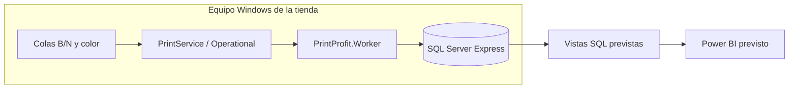
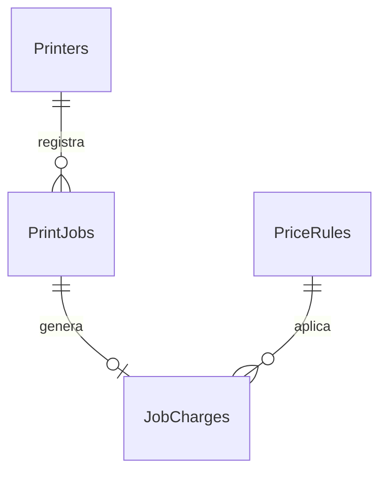

# PrintProfit — Descripción del proyecto, detalles técnicos y lógica de negocio

**Fecha:** 28 de octubre de 2026  
**Repositorio:** [fabriyvera/PrintProfit.Worker](https://github.com/fabriyvera/PrintProfit.Worker)  
**Rama revisada:** `version-1`  
**Commit de referencia:** [a3e3b0b](https://github.com/fabriyvera/PrintProfit.Worker/commit/a3e3b0baf68b493d4f695a4048297ca41a0b80c4)  
**Estado:** prototipo en desarrollo para la versión 1.

Este documento explica qué problema resuelve PrintProfit, cómo funciona su arquitectura y cuáles son sus reglas de negocio. Distingue el código existente del comportamiento previsto. Los objetos SQL, reportes y mecanismos de recuperación descritos como pendientes no deben interpretarse como funcionalidades terminadas.

## 1. Descripción general

PrintProfit es un sistema local para una tienda de impresiones. Su propósito es construir un historial de trabajos impresos y asociar a cada uno un cargo calculado según el número de páginas y el modo de impresión.

La solución está diseñada para ejecutarse en un equipo Windows conectado a las impresoras del negocio. Un Worker Service en .NET escucha eventos de impresión y envía los datos a SQL Server Express. Power BI utilizará esos datos para mostrar indicadores de volumen y facturación estimada por periodo, impresora y modo.

El flujo objetivo es:

```text
Trabajo de impresión
    → cola lógica de Windows
    → evento de PrintService
    → lectura y validación por el Worker
    → registro del trabajo y su cargo en SQL
    → vistas analíticas
    → reportes de Power BI
```

### Problema que resuelve

La cola de Windows permite observar trabajos en curso, pero el negocio necesita un historial persistente para responder preguntas como:

- ¿Cuántas páginas se imprimieron hoy, esta semana o este mes?
- ¿Qué parte corresponde a B/N y qué parte a color?
- ¿Qué cargos generan las impresiones registradas?
- ¿Qué impresoras concentran mayor volumen?
- ¿Cómo evoluciona la actividad del negocio?

### Alcance del MVP

El MVP contempla captura de trabajos, clasificación por cola, persistencia, cálculo de cargos e indicadores. Su diseño inicial se limita a un equipo que concentra las colas y los eventos relevantes.

No incluye todavía gestión de clientes, caja, pagos, inventario, costos de tinta o papel, utilidad neta, descuentos ni devoluciones. El nombre PrintProfit no significa que ya exista un cálculo de rentabilidad: para calcular utilidad habría que incorporar costos e ingresos efectivamente conciliados.

## 2. Contexto operativo

### Impresoras del negocio

| Dispositivo | Capacidad prevista | Colas propuestas |
|---|---|---|
| Epson L14150 | B/N y color | Epson_L14150_BN y Epson_L14150_COLOR |
| Epson L565 | B/N y color | Epson_L565_BN y Epson_L565_COLOR |
| Epson L5590 | B/N y color | Epson_L5590_BN y Epson_L5590_COLOR |
| KONICA Bizhub 364 | B/N | KONICA_Bizhub364_BN |

Los nombres son propuestas del diseño. Se deben confirmar los nombres reales en Windows y registrarlos exactamente en el catálogo SQL.

### Qué es una cola lógica

Una cola lógica es una configuración de impresora en Windows con nombre y preferencias propios. Dos colas pueden apuntar al mismo dispositivo físico:

- Una cola configurada para blanco y negro.
- Otra cola configurada para color.

PrintProfit utiliza la cola elegida como fuente de clasificación. El sufijo del nombre permite identificar el modo previsto, pero no obliga al hardware a imprimir de ese modo: las preferencias de cada cola y los permisos para cambiarlas deben verificarse en la tienda.

### Responsabilidades operativas

| Participante | Responsabilidad |
|---|---|
| Operador de la tienda | Elegir la cola correcta y verificar que el trabajo corresponda al servicio solicitado. |
| Administrador del sistema | Configurar colas, tarifas, SQL, permisos del servicio y respaldos. |
| Worker | Capturar y transmitir los eventos disponibles sin duplicar ni perder trabajos una vez completados los mecanismos de fiabilidad. |
| SQL Server | Aplicar el contrato de persistencia y las reglas de cargo previstas. |
| Power BI | Presentar los datos registrados con criterios de periodo y agregación consistentes. |

Impresiones directas desde USB, copias hechas desde el panel del equipo u otros trabajos que no generen eventos en el Windows supervisado quedan fuera del alcance de captura del Worker.

## 3. Lógica de negocio

Las reglas de esta sección describen el comportamiento objetivo del MVP. El repositorio todavía no contiene los scripts que permitan comprobar su implementación en SQL.

### RN-01. Un evento representa un trabajo, no una venta completa

Un trabajo puede contener varias páginas. Una venta puede contener varios trabajos. El sistema no debe confundir ninguno de esos conceptos.

Ejemplo: un cliente solicita dos documentos y el operador envía dos trabajos. PrintProfit registra dos trabajos con sus cargos; no crea automáticamente una venta ni identifica al cliente.

El evento 307 es la señal utilizada por el prototipo para registrar un trabajo como `COMPLETED`. Esta señal del sistema de impresión no acredita por sí sola que el cliente recibió el material o pagó.

### RN-02. Clasificación por cola

El modo se obtiene de la cola registrada:

| Cola | Modo de negocio |
|---|---|
| Cola reconocida con sufijo _BN | BN |
| Cola reconocida con sufijo _COLOR | COLOR |
| Cola desconocida o sin modo válido | Revisión o auditoría; no asignar precio por suposición. |

Debe existir una correspondencia consistente entre nombre de cola, dispositivo físico y modo.

Una cola COLOR implica tarifa color para las páginas cobrables de ese trabajo, incluso si alguna página contiene solo texto negro. El MVP no analiza el contenido de cada página para aplicar precios mixtos.

La clasificación y la resolución del catálogo están previstas en SQL; el Worker actual envía QueueName y no calcula el modo.

### RN-03. Tarifas iniciales

| Modo | Precio por página |
|---|---:|
| BN | Bs. 0,50 |
| COLOR | Bs. 1,50 |

Estos valores corresponden al diseño inicial compartido por el propietario. Su existencia en una base instalada no se ha verificado.

### RN-04. Cálculo del cargo

La fórmula prevista es:

```text
Importe del trabajo = Páginas cobrables × Precio por página
```

Ejemplos:

| Trabajo | Páginas cobrables | Precio unitario | Importe |
|---|---:|---:|---:|
| Documento B/N | 10 | Bs. 0,50 | Bs. 5,00 |
| Documento color | 4 | Bs. 1,50 | Bs. 6,00 |
| Trabajo B/N | 6 | Bs. 0,50 | Bs. 3,00 |
| Trabajo color | 3 | Bs. 1,50 | Bs. 4,50 |

Los últimos dos trabajos suman Bs. 7,50. Ese total es la suma de cargos calculados; no confirma un pago.

Los importes deben almacenarse como decimales, evitando tipos de punto flotante para dinero. La precisión y escala definitivas se deben fijar en el esquema SQL.

### RN-05. Condiciones para generar un cargo

Un trabajo solo debería generar un cargo si:

1. Corresponde a un evento de finalización admitido.
2. La cola existe y permite resolver un modo válido.
3. El número de páginas cobrables es mayor que cero.
4. Hay una tarifa vigente para el modo y la fecha aplicable.
5. No se ha cobrado previamente el mismo evento de origen.

Un dato ausente no debe convertirse automáticamente en cero ni en una página. La decisión de conservar trabajos inválidos y su mecanismo de auditoría deben implementarse explícitamente.

### RN-06. Páginas, copias y doble cara

Se deben distinguir tres magnitudes:

| Magnitud | Significado |
|---|---|
| Páginas del documento | Contenido lógico del archivo. |
| Caras impresas | Cantidad de caras que reciben impresión. |
| Hojas físicas | Papel consumido, que puede tener una o dos caras impresas. |

El diseño comercial habla de precio por página. Para cerrar la versión 1 debe confirmarse si la unidad cobrable será cada cara impresa y comprobar cómo cada driver informa el evento.

Ejemplo si se adopta cobro por cara: un documento de 2 páginas impreso en 3 copias representa 6 caras cobrables. Con doble cara podría utilizar 3 hojas; el cargo por cara seguiría usando 6 unidades.

El ejemplo define una expectativa de negocio, no el contenido garantizado de un evento 307. No se debe multiplicar automáticamente el valor del evento por las copias sin validar primero si el driver ya las incluyó.

### RN-07. Vigencia de precios

Las tarifas deben tener periodos de vigencia. Una nueva tarifa debe crear una nueva regla de precio, conservando el historial anterior.

Para un mismo modo no deberían existir dos tarifas aplicables al mismo instante. Se propone utilizar intervalos con inicio incluido y fin excluido:

```text
EffectiveFrom <= FechaAplicable
y
(EffectiveTo es nulo o FechaAplicable < EffectiveTo)
```

Falta acordar y codificar la fecha aplicable. Para el flujo basado en evento 307 se propone utilizar la fecha del evento de finalización, normalizada de forma consistente.

La fecha de ingesta no debería cambiar el precio de un trabajo recuperado. Si un trabajo ocurrió antes de un aumento de tarifa, registrarlo después del aumento debe conservar la tarifa que le correspondía por fecha.

### RN-08. Congelación del cargo histórico

Al registrar un cargo deben conservarse al menos:

- Las unidades cobradas.
- El precio unitario aplicado.
- El importe resultante.
- La referencia a la regla de precio.

Modificar una tarifa futura no debe recalcular trabajos anteriores. Las correcciones comerciales posteriores requerirían una política específica de ajuste o anulación, que queda fuera del MVP actual.

### RN-09. Idempotencia

Si se procesa dos veces el mismo evento, debe existir un solo trabajo y un solo cargo asociado.

La comprobación debe ser consistente incluso con dos inserciones concurrentes. Una consulta previa desde C# no basta: se requieren restricciones y transacciones en SQL.

`SourceEventRecordId` identifica el registro de origen dentro de su contexto. No debe asumirse que ese número es único para siempre al limpiar un canal o cambiar de equipo. La estrategia definitiva debe incluir contexto del origen y del ciclo del log, o un mecanismo equivalente.

`SourceJobId`, el identificador del trabajo en el spooler, es un dato útil de trazabilidad; no debe usarse por sí solo como identificador histórico global.

### RN-10. Casos excepcionales

| Situación | Tratamiento objetivo |
|---|---|
| Evento repetido | Confirmar que ya se procesó, sin crear un segundo cargo. |
| Cola desconocida | Conservar el diagnóstico y resolver el catálogo antes de cobrar. |
| Páginas ausentes, inválidas o cero | No inventar un importe; auditar. |
| Tarifa inexistente | No aplicar una tarifa arbitraria; marcar el caso para resolución. |
| Trabajo cancelado sin evento de finalización admitido | No generar un cargo por la vía de evento 307. |
| Reimpresión que genera un nuevo evento | Se detecta como otro trabajo; una cortesía comercial necesitaría una regla adicional. |
| SQL inaccesible temporalmente | Reintentar y recuperar trabajos disponibles cuando se implemente la ingesta durable. |
| Evento eliminado por retención antes de capturarlo | Registrar la incidencia si se detecta; no prometer recuperar datos ya inexistentes. |

## 4. Arquitectura técnica

### Componentes



El diseño concentra captura y almacenamiento en un equipo. Si las impresiones ocurren en otros equipos o servidores, primero hay que confirmar dónde se generan sus eventos; no basta con instalar el Worker en cualquier PC de la red.

### Tecnologías del repositorio

| Tecnología | Uso |
|---|---|
| C# y .NET Worker Service | Proceso de ingesta en segundo plano. |
| net9.0-windows | Framework objetivo actual del Worker. |
| net9.0 | Framework objetivo de Domain. |
| Microsoft.Extensions.Hosting | Host, configuración, inyección de dependencias y ciclo de vida. |
| Microsoft.Extensions.Hosting.WindowsServices | Integración con el servicio de Windows. |
| System.Diagnostics.Eventing.Reader | Consulta y escucha del canal de eventos. |
| Microsoft.Data.SqlClient | Conexiones y comandos SQL parametrizados. |
| Serilog | Paquetes declarados; integración y archivos de logs pendientes. |
| SQL Server Express | Persistencia y reglas de cargo previstas. |
| Power BI Desktop | Visualización prevista de indicadores. |

### Paquetes declarados en el Worker

| Paquete | Versión |
|---|---|
| Microsoft.Data.SqlClient | 7.0.1 |
| Microsoft.Extensions.Hosting | 9.0.15 |
| Microsoft.Extensions.Hosting.WindowsServices | 9.0.15 |
| Serilog.Extensions.Hosting | 10.0.0 |
| Serilog.Sinks.File | 7.0.0 |

Estas son las versiones declaradas en el commit revisado; no representan una recomendación de actualización a las versiones más recientes.

## 5. Organización del código

```text
PrintProfit/
├── .gitignore
├── README.md
├── CHANGELOG.md
├── PrintProfit.Worker.sln
├── PrintProfit.Domain/
│   ├── Class1.cs
│   └── PrintProfit.Domain.csproj
├── PrintProfit.Worker/
│   ├── Program.cs
│   ├── PrintIngestionService.cs
│   ├── PrintOperationalLogReader.cs
│   ├── SqlPrintRepository.cs
│   ├── PrintJobInsertDto.cs
│   ├── PrintServiceOptions.cs
│   ├── Worker.cs
│   ├── appsettings.json
│   ├── PrintProfit.Worker.csproj
│   └── Properties/launchSettings.json
└── docs/
    └── PROYECTO.md
```

### Program.cs

Construye el host y registra, antes de Build():

1. La integración con Windows Services, con nombre PrintProfit Worker.
2. Las opciones de la sección PrintService.
3. SqlPrintRepository como singleton.
4. PrintIngestionService como servicio alojado.

Finalmente construye y ejecuta el host. El registro de AddWindowsService prepara la integración; instalar el servicio en Windows es una acción de despliegue separada.

### PrintIngestionService

Es un BackgroundService que:

- Obtiene la configuración y las dependencias por inyección.
- Crea el lector de eventos.
- Entrega al lector una función que inserta el DTO en SQL.
- Mantiene la ejecución hasta recibir cancelación.
- Desecha el lector al finalizar.

### PrintOperationalLogReader

Crea un EventLogQuery para el canal configurado, filtrado por Event ID 307. Utiliza EventLogWatcher y procesa EventRecordWritten.

Actualmente transforma el evento y lanza una Task.Run para guardarlo. Registra mensajes de éxito o de error mediante ILogger.

Este flujo funciona como prototipo, pero no contiene todavía una posición durable de lectura, reintentos persistentes ni espera de las inserciones pendientes al detenerse.

### SqlPrintRepository

Lee la cadena ConnectionStrings:PrintProfit. Por cada inserción:

1. Abre una SqlConnection.
2. Crea un SqlCommand de tipo StoredProcedure.
3. Añade los parámetros del DTO.
4. Ejecuta dbo.usp_InsertPrintJobWithCharge de forma asíncrona.

La clase no calcula precios. Depende del procedimiento almacenado para las reglas de negocio previstas. Actualmente utiliza AddWithValue; al versionar SQL deberán alinearse tipos, tamaños y nulabilidad del contrato.

### PrintProfit.Domain

El proyecto existe y está referenciado desde el Worker, pero solo contiene Class1 vacía. Todavía no implementa reglas ni modelos compartidos.

### Worker.cs

Es la clase de la plantilla inicial. Program.cs registra PrintIngestionService, por lo que Worker.cs no es el componente de ingesta activo.

## 6. Datos y contrato de integración

### PrintJobInsertDto

| Campo | Tipo C# | Uso |
|---|---|---|
| SourceEventRecordId | long? | Identificador del registro de eventos. |
| SourceJobId | int? | Identificador del trabajo del spooler. |
| QueueName | string requerido | Cola utilizada. |
| DocumentName | string? | Nombre del documento, si está disponible. |
| SubmittedBy | string? | Usuario informado por el evento. |
| TotalPages | int? | Páginas reportadas; deben validarse antes del cargo. |
| TotalBytes | long? | Tamaño reportado. |
| JobStatus | string requerido | Estado del trabajo; actualmente COMPLETED. |
| SubmittedAt | DateTime | Campo de fecha enviado actualmente al procedimiento. |
| CompletedAt | DateTime? | Fecha de finalización enviada al procedimiento. |

En el código actual, SubmittedAt y CompletedAt reciben la misma hora del evento. Por tanto, SubmittedAt no representa una medición independiente de la hora original de envío.

### Procedimiento almacenado esperado

```text
dbo.usp_InsertPrintJobWithCharge

@SourceEventRecordId
@SourceJobId
@QueueName
@DocumentName
@SubmittedBy
@TotalPages
@TotalBytes
@JobStatus
@SubmittedAt
@CompletedAt
```

El procedimiento se invoca desde C#, pero su definición no está incluida en el repositorio revisado. No se ha verificado el esquema instalado en el equipo del usuario.

### Transacción prevista

```text
BEGIN TRANSACTION
    identificar evento y comprobar duplicado
    validar cola, modo, páginas y tarifa
    insertar PrintJob
    insertar JobCharge si el trabajo es cobrable
COMMIT
```

El diseño debe definir qué resultados se consideran procesados, cuáles requieren revisión y cuáles deben reintentarse. Trabajo y cargo no deberían quedar a medias por un error durante la operación.

## 7. Modelo de datos previsto

Los siguientes objetos son un diseño objetivo, no tablas verificadas en el repositorio.

| Entidad | Propósito | Información principal |
|---|---|---|
| Printers | Catálogo de colas | Cola, nombre físico, modo o regla para resolverlo. |
| PriceRules | Tarifas con vigencia | Modo, precio, inicio y fin de vigencia. |
| PrintJobs | Historial de trabajos | Identidad del evento, cola, usuario, documento, páginas, bytes, estado y fechas. |
| JobCharges | Historial de cargos | Trabajo, regla aplicada, precio unitario, unidades e importe. |
| IngestionLog | Auditoría | Error o descarte, evento relacionado y diagnóstico. |
| Estado de ingesta | Recuperación | Posición confirmada y contexto del origen. |

### Relaciones previstas



Un trabajo puede no tener cargo, pero no debería tener más de uno en el MVP. Varias colas del catálogo pueden apuntar al mismo dispositivo físico.

### Integridad requerida

- Cola única dentro del contexto de instalación acordado.
- Identidad de evento con protección contra duplicados.
- Un cargo como máximo por trabajo.
- Referencias válidas entre trabajos, impresoras, tarifas y cargos.
- Tarifas positivas y periodos coherentes.
- Unidades cobradas mayores que cero.
- Inserciones transaccionales con comportamiento definido ante concurrencia.

Los scripts previstos son schema.sql, seed.sql, usp_InsertPrintJobWithCharge.sql y views_kpi.sql, dentro de una futura carpeta database/.

## 8. Lectura del evento 307 y corrección pendiente

El canal utilizado es:

```text
Microsoft-Windows-PrintService/Operational
```

La revisión identificó que el mapeo actual utiliza posiciones incorrectas. La estructura habitual que deberá contrastarse con XML reales del equipo es:

| Parámetro | Índice esperado | Dato |
|---|---:|---|
| Param1 | 0 | ID del trabajo |
| Param2 | 1 | Documento |
| Param3 | 2 | Usuario |
| Param4 | 3 | Equipo de origen |
| Param5 | 4 | Cola/impresora |
| Param6 | 5 | Puerto |
| Param7 | 6 | Bytes |
| Param8 | 7 | Páginas reportadas |

El código revisado lee [0] como documento, [1] como usuario, [2] como cola, [3] como bytes y [4] como páginas. Además, SourceJobId queda nulo y solo se exige la existencia de cinco propiedades.

Esto puede enviar el usuario como QueueName y producir páginas nulas al intentar convertir un nombre de impresora a número. La compilación correcta no detecta este error semántico.

La corrección deberá validar estructura, identificadores y valores numéricos. También debe contemplar EventException del watcher, que actualmente no se examina cuando no hay EventRecord.

## 9. Fiabilidad y recuperación

### Comportamiento actual

- Escucha eventos nuevos.
- Intenta insertar cada DTO mediante una tarea independiente.
- Si SQL falla, registra el error.
- No conserva una posición durable ni una lista persistente de pendientes.
- No espera explícitamente todas las inserciones al detener el servicio.

### Comportamiento requerido para versión 1

1. Retomar eventos disponibles después de un reinicio.
2. Confirmar la posición de lectura después de la persistencia o del tratamiento durable acordado.
3. Reintentar errores temporales sin duplicar cargos.
4. Limitar concurrencia para controlar carga y orden de confirmación.
5. Detenerse de forma controlada, con tratamiento explícito de trabajos pendientes.
6. Detectar o diagnosticar problemas del watcher y del canal.
7. Documentar el límite impuesto por limpieza o retención de eventos.

No basta con añadir reintentos en memoria: si el proceso termina, los datos pendientes deben poder recuperarse del canal o de otro almacenamiento durable.

## 10. Configuración y ejecución

### Ejemplo de appsettings.json

```json
{
  "ConnectionStrings": {
    "PrintProfit": "Server=.\\SQLEXPRESS;Database=PrintProfitDB;Integrated Security=True;Encrypt=True;TrustServerCertificate=True;"
  },
  "PrintService": {
    "LogName": "Microsoft-Windows-PrintService/Operational"
  }
}
```

Es un ejemplo para una instancia local. La configuración versionada actualmente apunta a LAPTOP-DV25BA42\\SQLEXPRESS.

Con autenticación integrada, SQL utiliza la identidad del proceso. La cuenta del servicio debe tener permisos de lectura del canal y de acceso a SQL; esos permisos pueden diferir de los del usuario que ejecuta Visual Studio.

Serilog y su destino File están declarados como paquetes, pero Program.cs aún no configura la integración ni los archivos de log.

### Compilación

Desde la raíz de la solución, en PowerShell de Windows y con el SDK compatible instalado:

```powershell
dotnet restore PrintProfit.Worker.sln
dotnet build PrintProfit.Worker.sln -c Release
```

El usuario aportó una compilación Release exitosa con SDK 9.0.318 y 28 advertencias CA1416 antes de cambiar el Worker a net9.0-windows. No se ha recibido todavía un resultado posterior que confirme la recompilación sin esas advertencias.

La ejecución con impresoras y SQL requiere validaciones separadas. WSL puede utilizarse para Git, pero no sustituye el acceso del proceso Windows al registro de eventos.

## 11. Reportes e indicadores previstos

| Indicador | Definición |
|---|---|
| Total de trabajos | Número de trabajos admitidos por el criterio del reporte. |
| Páginas BN | Suma de unidades del modo BN. |
| Páginas COLOR | Suma de unidades del modo COLOR. |
| Total de páginas | BN + COLOR, con el mismo criterio de inclusión. |
| Total de cargos | Suma de importes históricos de JobCharges. |
| Mix color | Páginas COLOR / Total de páginas × 100. |
| Cargos por impresora | Suma por dispositivo físico o cola, según la dimensión elegida. |

Ejemplo: 80 páginas BN y 20 COLOR representan 100 páginas y un mix color de 20 %. Si las tarifas iniciales son aplicables a todas, el cargo total sería Bs. 70,00.

Para periodos sin páginas debe definirse si el mix se presenta como cero o sin dato, evitando división por cero. Los reportes también deben distinguir trabajos registrados, trabajos cobrables y trabajos pendientes de revisión.

### Vistas propuestas

- vw_PrintFact: detalle de trabajos y cargos.
- vw_KpiWeekly: agregados por semana ISO.
- vw_KpiMonthly: agregados mensuales.
- vw_KpiYearly: agregados anuales.
- vw_KpiRevenueByPrinter: agregados por impresora y periodo.

Una semana ISO requiere año ISO y número de semana, o una fecha de inicio inequívoca. La fecha y zona horaria de agrupación deben acordarse; para la operación del negocio se propone America/La_Paz.

Para el total monetario, los reportes deben usar el cargo histórico almacenado, evitando recalcular todo con la tarifa actual. No existe todavía un archivo Power BI ni vistas SQL versionadas en la rama revisada.

## 12. Cambios realizados

| Fecha | Cambio | Resultado |
|---|---|---|
| 2 de octubre de 2026 | Reorganización de la solución | Worker y Domain dentro del mismo repositorio; solución en la raíz. |
| 2 de octubre de 2026 | Documentación y rama version-1 | README, documentación y registro de cambios. |
| 3 de octubre de 2026 | Framework del Worker | Cambio de net9.0 a net9.0-windows para declarar la plataforma requerida. |
| 28 de octubre de 2026 | Este documento | Descripción integrada de negocio, arquitectura, contrato de datos y pendientes. |

Este documento describe el commit de referencia de version-1. Su publicación en main no incorpora los cambios de código de esa rama.

## 13. Estado y criterios para completar la versión 1

| Área | Estado comprobado | Pendiente |
|---|---|---|
| Organización | Worker y Domain incluidos; rutas reorganizadas. | Mantener estructura y documentación. |
| Host | Servicio de ingesta registrado. | Validar instalación y cuenta real del servicio. |
| Plataforma | Worker dirigido a Windows. | Confirmar recompilación posterior al ajuste. |
| Lectura de eventos | Watcher 307 implementado. | Corregir mapeo y probar con eventos reales. |
| Persistencia | Llamada SQL implementada. | Versionar y probar esquema y procedimiento. |
| Cobro | Reglas definidas en el diseño. | Implementar tarifas, transacción y cargos históricos. |
| Fiabilidad | Logs de éxito/error en el flujo. | Recuperación durable, reintentos y cierre controlado. |
| Logs en archivo | Paquetes disponibles. | Configurar Serilog y operación de archivos. |
| Analítica | KPIs definidos. | Crear vistas, reporte y conciliación. |

### Pruebas de aceptación

- Cola BN y COLOR de cada impresora aplicable correctamente identificadas.
- Trabajo de 10 páginas BN calculado en Bs. 5,00 con la tarifa inicial.
- Trabajo de 4 páginas COLOR calculado en Bs. 6,00 con la tarifa inicial.
- Copias y doble cara contrastadas con el valor real del evento y la unidad comercial acordada.
- Evento repetido sin trabajo ni cargo duplicados, incluso ante concurrencia.
- Tarifa histórica correcta cuando la ingesta ocurre después de un cambio de precio.
- Cola desconocida y páginas inválidas tratadas sin cobro inventado.
- Recuperación tras caída temporal de SQL y reinicio del proceso.
- Totales analíticos iguales a los cargos y unidades de los datos de prueba.
- Ejecución validada bajo la cuenta del servicio, con logs y respaldo/restauración comprobados.

### Decisiones de negocio por cerrar

1. Confirmar que la unidad cobrable es la cara impresa y definir el tratamiento de copias y doble cara.
2. Confirmar que todos los trabajos enviados a COLOR llevan tarifa color, aunque contengan páginas negras.
3. Acordar cómo se atenderán reimpresiones de cortesía y errores del operador.
4. Fijar la fecha aplicable a tarifas y los criterios de periodo de los reportes.
5. Definir el procedimiento para resolver trabajos sin tarifa, sin páginas o con cola desconocida.

Estas decisiones deben convertirse en reglas verificables y pruebas antes del uso diario en la tienda.

## 14. Referencias del proyecto

Las referencias están fijadas al commit revisado para que este documento sea reproducible:

- [Documento de proyecto existente](https://github.com/fabriyvera/PrintProfit.Worker/blob/a3e3b0baf68b493d4f695a4048297ca41a0b80c4/docs/PROYECTO.md).
- [Registro y configuración del host](https://github.com/fabriyvera/PrintProfit.Worker/blob/a3e3b0baf68b493d4f695a4048297ca41a0b80c4/PrintProfit.Worker/Program.cs).
- [Servicio de ingesta](https://github.com/fabriyvera/PrintProfit.Worker/blob/a3e3b0baf68b493d4f695a4048297ca41a0b80c4/PrintProfit.Worker/PrintIngestionService.cs).
- [Lector de eventos](https://github.com/fabriyvera/PrintProfit.Worker/blob/a3e3b0baf68b493d4f695a4048297ca41a0b80c4/PrintProfit.Worker/PrintOperationalLogReader.cs).
- [Repositorio SQL](https://github.com/fabriyvera/PrintProfit.Worker/blob/a3e3b0baf68b493d4f695a4048297ca41a0b80c4/PrintProfit.Worker/SqlPrintRepository.cs).
- [DTO](https://github.com/fabriyvera/PrintProfit.Worker/blob/a3e3b0baf68b493d4f695a4048297ca41a0b80c4/PrintProfit.Worker/PrintJobInsertDto.cs).
- [Dependencias y framework del Worker](https://github.com/fabriyvera/PrintProfit.Worker/blob/a3e3b0baf68b493d4f695a4048297ca41a0b80c4/PrintProfit.Worker/PrintProfit.Worker.csproj).
